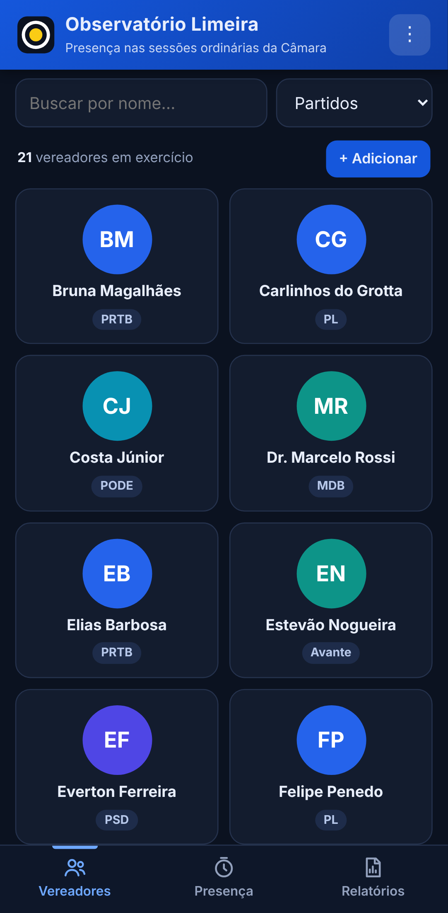
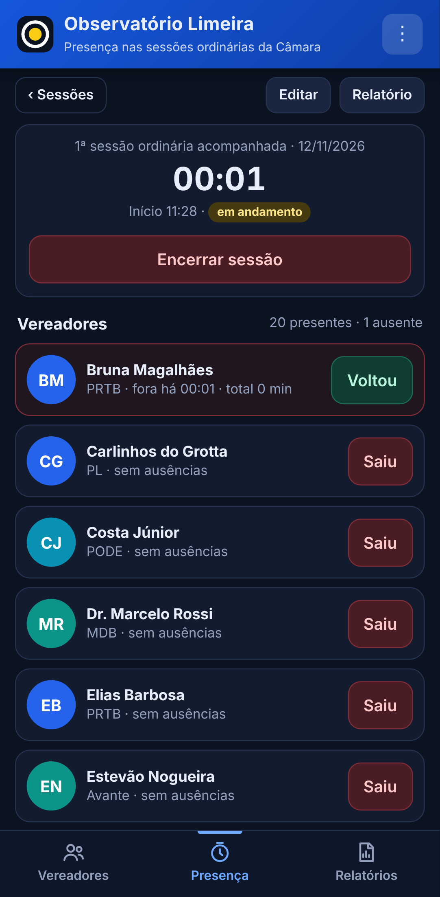

# Observatório Limeira

Aplicativo para acompanhar a **presença dos vereadores nas sessões ordinárias da Câmara Municipal de Limeira – SP**. O observador registra, em tempo real, quando cada vereador sai e volta ao plenário. O aplicativo soma os intervalos e calcula o tempo de ausência, o tempo de presença e o percentual de permanência de cada parlamentar.

Projeto desenvolvido para a disciplina de Administração de Sistemas de Informação (GL608).

<p align="center">
  
  
</p>

## Funcionalidades

- **Vereadores:** os 21 vereadores em exercício na legislatura 2025–2028, com nome parlamentar, nome completo e partido. Inclui busca por nome, filtro por partido, inclusão de foto e cadastro de suplentes.
- **Presença ao vivo:** cronômetro da sessão e botões **Saiu** / **Voltou** para cada vereador.
- **Registro manual:** ausências podem ser lançadas depois, informando o horário de saída e de retorno (ou a duração). Também é possível marcar a falta na sessão inteira.
- **Cálculo sem dupla contagem:** intervalos sobrepostos são unidos antes da soma.
- **Relatórios:** por sessão e geral (todas as sessões encerradas), com detalhamento individual, exportação em planilha (CSV) e resumo em texto.
- **Cópia de segurança:** exportação e restauração dos dados em JSON.

### Metodologia de cálculo

| Medida | Fórmula |
|---|---|
| Tempo de ausência | soma dos intervalos de ausência, sem sobreposição |
| Tempo de presença | duração monitorada − tempo de ausência |
| Percentual de presença | tempo de presença ÷ duração monitorada × 100 |

Exemplo: sessão monitorada por 120 min, com 25 min de ausência → 95 min presente → **79,2%**.

Os dados refletem a **permanência observada** durante o período acompanhado e não substituem o registro oficial de comparecimento da Câmara.

## Versões

O mesmo aplicativo (HTML, CSS e JavaScript, sem dependências externas) é distribuído em três formatos:

| Pasta | Plataforma | Onde os dados ficam |
|---|---|---|
| [`android/`](android) | APK para Android 6.0 ou superior (WebView nativo) | no aparelho |
| [`windows/`](windows) | Programa e instalador para Windows 10/11 64 bits (WebView2) | `%APPDATA%\ObservatorioLimeira\dados.json` |
| [`web/`](web) | Página web, abre em qualquer navegador | no navegador (`localStorage`) |

A interface fica em `android/assets/index.html` (Android e Windows usam o mesmo arquivo) e em `web/index.html` (versão web, com confirmações dentro da própria página e exportação adaptada).

## Como compilar

### Android

Requisitos: JDK 17+, `aapt`, `dalvik-exchange` (dx), `zipalign`, `apksigner` e a plataforma Android 23 (`android.jar`). No Ubuntu/Debian:

```bash
sudo apt install openjdk-17-jdk-headless aapt dalvik-exchange zipalign apksigner android-sdk-platform-23
cd android && ./build.sh
```

O APK assinado sai em `android/build/ObservatorioLimeira.apk`. Na primeira compilação o script cria uma chave de assinatura em `android/build/release.jks`. Guarde essa chave: atualizações do app precisam ser assinadas com a mesma chave.

### Windows

Requisitos: Go 1.22+ e NSIS 3 (`makensis`). Pode ser compilado no Linux (compilação cruzada) ou no próprio Windows.

```bash
cd windows && ./build.sh
```

Gera `windows/dist/ObservatorioLimeira.exe` e o instalador `windows/dist/ObservatorioLimeira-Instalador.exe`. O instalador não pede administrador, cria atalhos na área de trabalho e no menu Iniciar e registra o desinstalador. Em computadores sem o componente Microsoft Edge WebView2, o app abre no navegador padrão.

### Web

Não precisa compilar: abra `web/index.html` no navegador.

**Publicar no Vercel:** em vercel.com, *Add New › Project*, importe este repositório e clique em *Deploy*, sem mudar nenhuma opção. O arquivo `vercel.json` já faz o endereço principal abrir a versão web, e o `.vercelignore` deixa as pastas `android/` e `windows/` fora do site. Cada envio para o GitHub atualiza o site automaticamente.

Na versão publicada fora do claude.ai, os dados ficam salvos no navegador de cada pessoa (não são compartilhados entre observadores). Use a cópia de segurança do menu (⋮) para levar os registros de um aparelho para outro.

## Estrutura

```
android/
  AndroidManifest.xml
  assets/index.html        interface do app
  res/                     ícones e tema
  src/.../MainActivity.java  WebView, arquivos, compartilhar, imprimir
  build.sh
windows/
  main_windows.go          janela WebView2, pasta de dados, instância única
  server.go                servidor local (127.0.0.1) que entrega a interface e grava os dados
  index.html               interface do app
  app.manifest, app.ico    manifesto e ícone do executável
  installer.nsi            instalador (NSIS)
  build.sh
web/
  index.html               versão web
docs/
  telas/                   capturas de tela
vercel.json                publicação da versão web no Vercel
.vercelignore              pastas que não vão para o site
```

## Fonte da lista de vereadores

Página “Legislatura atual” da Câmara Municipal de Limeira: <https://www.limeira.sp.leg.br/vereadores/legislatura_atual> (consultada em 12/11/2026). A lista pode ser editada no próprio aplicativo quando houver posse de suplentes ou troca de partido.
